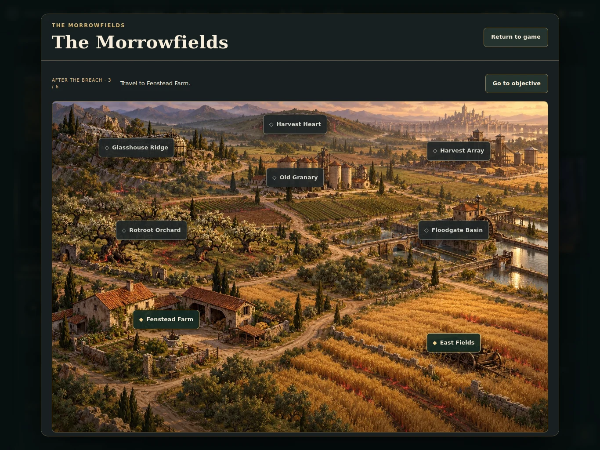
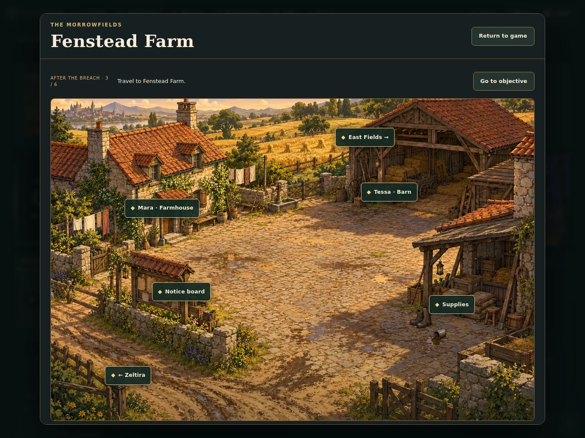
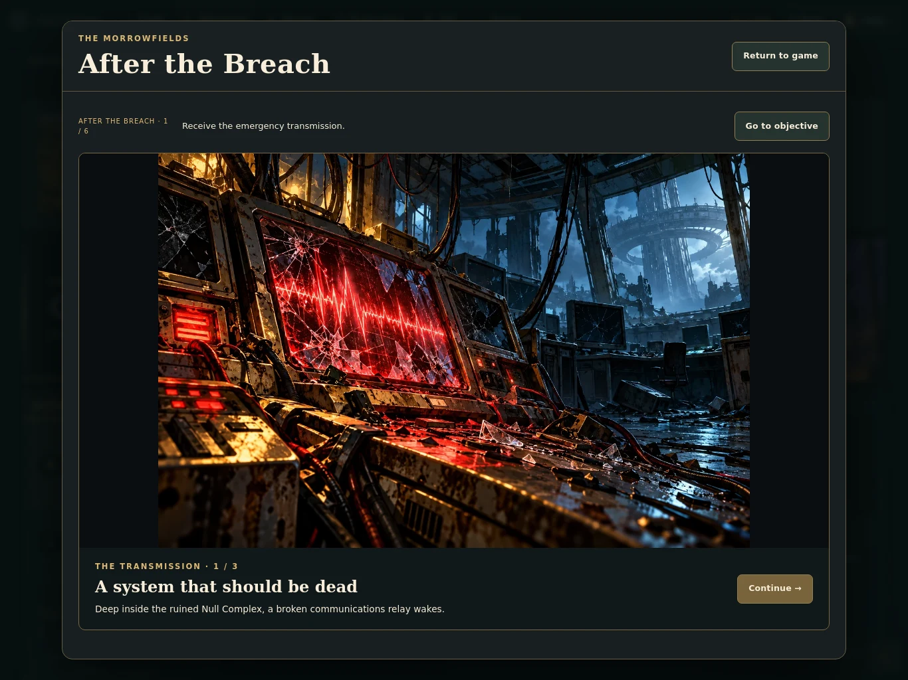
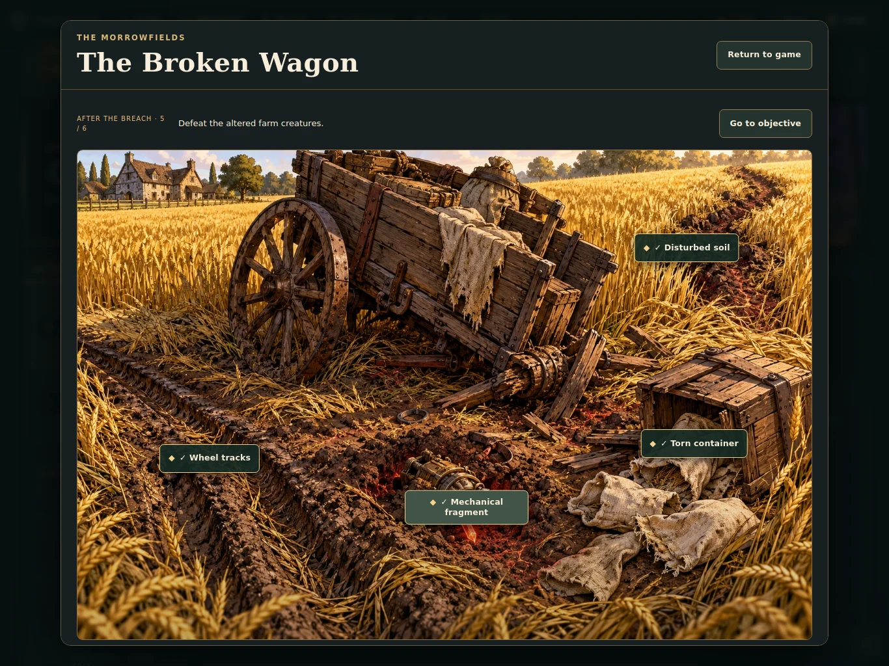
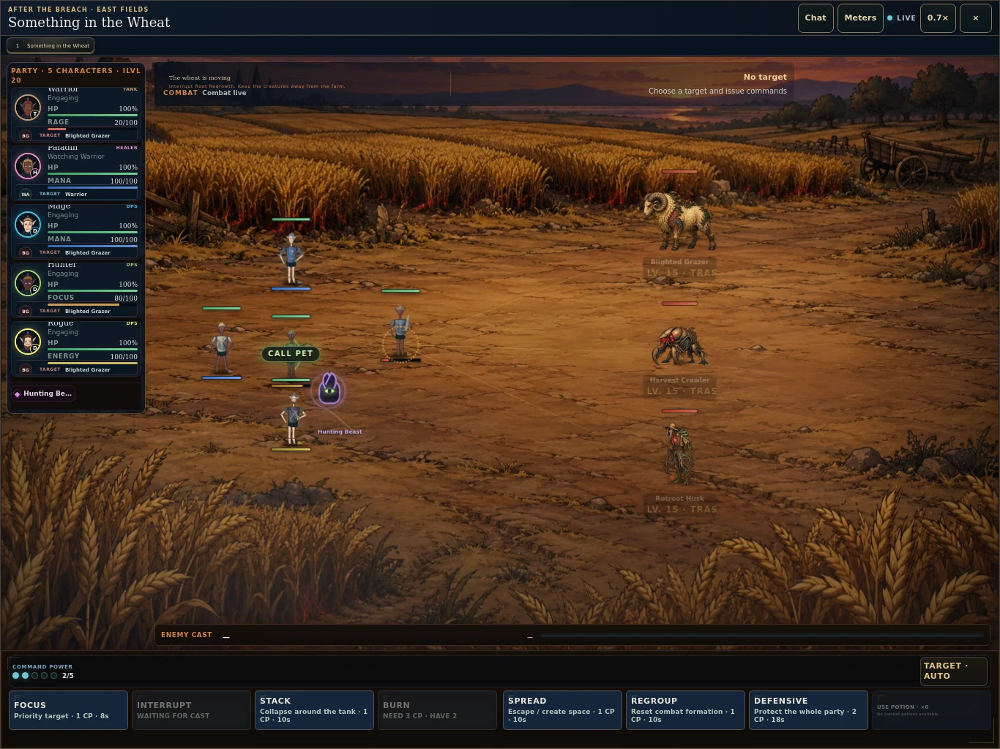
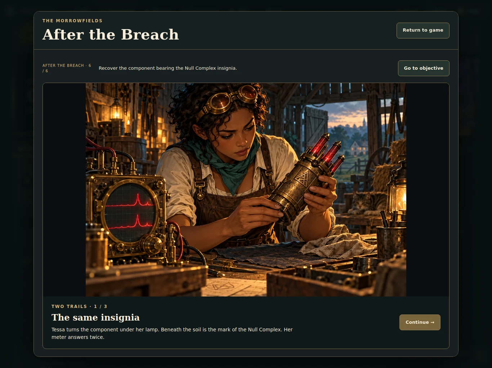
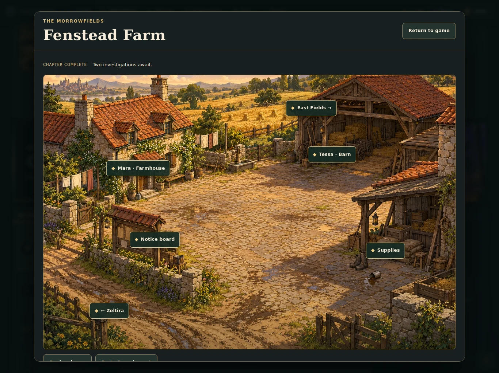

# Block 3A validation — 17 October 2026

Branch: `codex/episode-2-morrowfields`, stacked on PR #225 at `4a4fe011bc6cb953361939fc85b2181672abe4c8`, retaining PR #224.

**Local playable implementation verified; hosted acceptance blocked. No deployment, production schema change, player-data mutation or official episode activation was performed.**

## Test results

| Gate | Result |
| --- | --- |
| `npm run build` | PASS |
| `npm run test:core` | 75/75 PASS |
| `npm run test:appearance` | PASS |
| `npm run test:talents` | PASS |
| `npm run test:role-balance` | PASS; 386 seeded simulations; 119/120 tank/healer combination victories |
| `tests/morrowfields-opening.cjs` | 32 checks PASS against disposable PostgreSQL and the canonical combat engine |
| `tests/morrowfields-http.cjs` | PASS: authenticated identity, forged account IDs, missing/invalid tokens, origin, request limit, cache policy |
| `tests/morrowfields-art.cjs` | PASS: 14 unique chapter assets and three six-pose monster atlases |
| `tests/monster-art.cjs` | PASS: all 102 existing/new atlases, packing and size budget |
| `tests/morrowfields-opening.browser.cjs` | PASS: full six-objective path at 1366×1024, 390×844 and 1440×900 in Chromium |
| `npm run test:browser` | 35/35 PASS in 982 seconds; includes Episode 1 shell, room transitions, monster animation catalogue and interface/performance regressions |
| WebKit / physical iPad Safari | NOT VERIFIED; WebKit runtime dependencies unavailable in this environment |
| Hosted Auth/PostgREST and production account isolation | NOT VERIFIED; isolated staging is not provisioned |

The existing Design Booth core test prints a caught mock-table assertion (`cellbound_design_templates` vs `cellbound_design_blueprints`) while exiting successfully. Its separate Chromium regression passes. This pre-existing test-double warning is not treated as evidence for live Design Booth backend correctness.

## Acceptance coverage and limits

| Requested behavior | Evidence / status |
| --- | --- |
| Genuine Null Complex completion unlocks the opening | Private trusted finale proof plus narrative state required. Invalid/missing proof rejected. **Upstream live finale verifier remains a blocker**; tests explicitly seed trusted proof. |
| Ineligible accounts cannot bypass prerequisites | Real SQL/service negative tests reject missing proof, missing narrative flag, closed production and forged account identity. |
| Morrowfields opens from existing game | Quest Journal entry → native chapter dialog; browser playthrough uses the built guild shell. |
| Fenstead navigable; Mara, Tessa and routes present | Browser path traverses regional map, farm, fields and wagon. Six future landmarks expose lock reasons without starting content. |
| Six ordered objectives | Transmission → briefing → Fenstead → wagon → creatures → component asserted in durable state. |
| Wagon objects | Four positioned clues; duplicates do not advance twice; mid-investigation reload resumes saved discoveries. |
| Real encounter | Shared Combat Reborn session/viewer; animated grazer/crawler/husk, party damage/healing, commands and victory verified. Forged victory over a defeated party rejected; retry tested. |
| Rewards | Exactly 4,300 XP per recorded active character and 180 gold. Completion/retry and concurrent CAS tests verify a single durable grant. |
| Both investigation branches | Existing `e2_q02` and `e2_q03` unlocked together; titles and first objectives shown, no unfinished launch buttons. |
| Persistence | PostgreSQL account snapshot, revision and attempt commit atomically; new authority instance reloads progress. Browser reload also covered. |
| Account separation | Two UUID accounts; client SQL grants denied; authenticated HTTP user supersedes body user ID. Hosted legacy cutover remains blocked. |
| Responsive presentation | Full chapter played at tablet, phone and desktop Chromium viewport sizes, with no page errors or horizontal overflow. No physical device claim. |
| Episode 1 retained | Existing core, appearance, combat and browser regression gates; existing room transitions/fades and hunter pet entry verified. No new combat engine. |
| Development without official activation | Development environment succeeds while release is unreleased; production access denied. Candidate schema is not auto-applied. |
| Official Episode 2 disabled | No activation call or release-state change. Existing deployment block retained unchanged. |

The browser harness uses real built application code, the actual opening authority and real local PostgreSQL through an intercepted test transport. The authentication shell and upstream finale proof are explicit fixtures. It does not establish a production login, execute the entire Null Complex storyline, or validate a remote trusted worker.

## Screenshots

All captures come from the actual interactive game, not design mockups. Tablet-size samples:

| Regional map | Fenstead Farm |
| --- | --- |
|  |  |

| Opening comic | Wagon investigation |
| --- | --- |
|  |  |

| Shared combat viewer | Closing comic |
| --- | --- |
|  |  |

Phone and desktop equivalents use the `390-` and `1440-` prefixes in this directory. `browser-results.json` records objective IDs, observed enemy animation frames and resulting roster/gold values. Artwork prompts and asset hashes are committed separately.

## Release blockers

1. Provision and verify an isolated development backend; `config/booth-release.json` still has `projectRef: null` and explicitly blocks shared-storage staging.
2. Complete PR #225's private-save cutover and trusted roster/equipment/economy mutations, including auditing privileged legacy writers.
3. Add an independently verified Null Complex finale producer for the private story-proof record. Never promote the old client completion flag into trusted evidence.
4. Deploy and validate the authenticated replay worker and candidate SQL against the isolated backend, with the exact approved client build.
5. Run hosted account/concurrency/access tests and physical iPad Safari acceptance.

Until these are resolved, this PR must remain a branch-based candidate and must not be deployed against shared production player data. See [implementation and deployment contract](../../morrowfields-opening.md).
